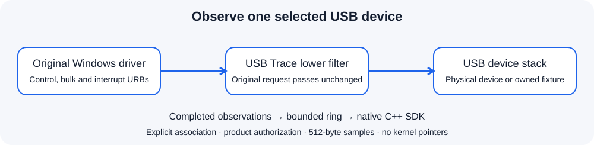

# USB Trace SDK - Microsoft-signed Windows Kernel USB Filter Driver & C++ API

**Observe USB request metadata and bounded payload samples from one explicitly selected USB device using a native C++ API.**

The private KMDF lower filter observes requests already issued by the device's Windows driver. The original function driver, reports and transfers continue unchanged. Use this SDK for firmware diagnostics, hardware integration, regression tests and OEM troubleshooting tools.



**Microsoft-signed evaluation, Windows x64.** The complete 0.1.1 ZIP includes the native app, CLI, C++ example, SDK, installer sources and self-contained UI/console installers with the signed 0.1.0.0 driver. Actual installation, control/interrupt observations and removal passed Windows 10 x64 campaigns normally and under targeted Driver Verifier, with test-signing disabled. See [validation and boundaries](docs/VALIDATION.md).

## Capabilities

| Capability | Scope |
| --- | --- |
| Explicit target | Associate the filter with an exact non-hub `USB\VID_...` device instance, then choose its current opaque module ID. |
| Request observations | Original USB function, submission/completion QPC timestamps, Windows/USB status, requested/actual lengths and a sequence number. |
| Payload samples | Up to 512 bytes: OUT at submission, IN after successful completion. Control setup bytes are recorded for supported control request layouts. |
| Endpoint information | Endpoint/type mappings from observed configuration/interface requests; unknown mappings are explicitly flagged. |
| Bounded work | 256 completed records, 16 records per read and at most 128 tracked in-flight requests. Overflow drops observations, never USB traffic. |
| Owner lifetime | One administrator/SYSTEM control owner; explicit Stop, close, permission expiry or device power-down clears capture and queued samples. |

Bulk and interrupt transfer layouts, ordinary/extended control transfers and documented class/vendor controls have bounded payload support. Other USB functions can appear as metadata-only observations. Isochronous packet contents, USB streams, wire-level bus decoding, USB redirection and device emulation are outside this edition. Use [Vdevice](https://github.com/TitanCSA/Vdevice) to create virtual USB protocol fixtures.

Inventory exposes at most 32 attached modules and 32 endpoint mappings per module. An unmapped endpoint remains explicitly unknown; the SDK does not infer a USB address from an opaque kernel pipe handle.

These are completed request observations. An indefinitely pending request has no completed record yet. Timestamps describe this filter's software boundary; they do not measure electrical packet timing or end-to-end application latency. Unsupported or changed completion layouts set `UT_ACTUAL_UNKNOWN` and/or `UT_PAYLOAD_UNAVAILABLE`; unknown is not reported as a confirmed zero-length transfer.

Attached filters keep bounded completion metadata for supported requests even while capture is inactive; they do not copy payloads without capture permission. An IN request already pending when capture starts can produce a completion observation marked `UT_SUBMITTED_BEFORE_CAPTURE`. Its IN data is sampled only at authorized completion. Pre-existing OUT requests remain metadata-only, with no older payload read. Requests already sampled for a previous capture generation are discarded when that generation changes. The `submitted` counter counts submissions during the active capture; `completed` also includes these explicitly marked pre-existing completions.

## Install and use

1. Extract the [complete signed ZIP](https://github.com/titanfyre/USB-Trace-SDK/releases/tag/v0.1.1). Run `USBTraceStudio.exe --preview` for a labelled offline tour; it opens no driver or USB device.
2. Request a USB Trace SDK access key from **`titancsa` on Discord**. Both self-contained setups are included; Windows test-signing is not required.
3. Run `USBTraceSetup.exe` as administrator and choose **Install / reinstall**. Both setup versions verify the exact product, Microsoft-root catalog signature and INF/SYS catalog membership. Restart only when requested.
4. Open `USBTraceStudio.exe`, select one exact USB device and choose **Attach filter**. This normally restarts only that device. Close applications using it first. A device restart can interrupt the device's current work.
5. Select the attached device, enter its product access key and choose **Authorize & observe**. Capture stays inactive until this explicit action. **Stop** clears stored samples. **Detach filter** removes only this service from that device and preserves other filter entries.

Only this selected device's `LowerFilters` association is changed. There is no global USB class filter, hub attachment, forced restart or replacement of its function driver. An association may remain after the studio closes; it remains passive until another authorized owner starts capture. Detach associations before uninstalling. Uninstall also attempts to remove this service's associations before removing the control driver and retains the package if that cannot finish safely.

The controlled Vdevice fixture required a virtual unplug/replug after a normal device restart even without this filter. Its VM test recreated only that owned fixture, with the same descriptors/serial and exact instance ID, before checking USB Trace. Physical-device restart/reconnect behavior and other filters remain separate compatibility work; the SDK does not claim universal restart support.

Console maintenance supports:

```powershell
USBTraceSetupConsole.exe /install
USBTraceSetupConsole.exe /devices
USBTraceSetupConsole.exe /attach "USB\VID_1209&PID_7A61\YOUR-EXACT-INSTANCE"
USBTraceSetupConsole.exe /detach "USB\VID_1209&PID_7A61\YOUR-EXACT-INSTANCE"
USBTraceSetupConsole.exe /uninstall
```

An exit code of `3010` requests a manual Windows restart. The installer never restarts Windows automatically. Never attach a capture filter to a device carrying irreplaceable work as an initial compatibility test.

## Minimal C++ integration

Copy all four files from `SDK/`, compile `USBTrace.cpp` with C++17 and link `winhttp.lib` and `crypt32.lib`.

```cpp
#include "USBTrace.h"

USBTrace trace; // Scope exit stops capture and closes this owner's handle.
auto modules = trace.Modules();
// Display modules and ask the operator to select one exact module.id.
auto error = trace.Authorize(accessKey); // Empty string means success.
if (!error.empty()) return;
error = trace.Start(selectedModuleId);
if (!error.empty()) return;

for (const auto& event : trace.Receive()) {
    // event.function, direction, endpoint, nt_status, usb_status
    // event.data[0 .. event.captured) contains the bounded sample.
}
```

`Modules()` enumerates attached filter modules, not all USB hardware. IDs last only for the current filter attachment; refresh after restart or removal. `Receive()` drains up to 16 completed observations and can return an empty vector. `Status()` returns active/authorized state, queue pressure and actual observation counters. `Start()` and `Authorize()` return English errors; inventory/receive/status errors throw `std::runtime_error`. Serialize calls on one SDK object. There is no capture/forward loop and no raw USB transmit API in this SDK.

Product-specific keys obtain signed per-handle permissions lasting at most one hour. Renew explicitly while the key remains enabled. Disabling a key refuses future grants; an already accepted permission remains valid until expiry, including its short challenge window. Keys are not machine-bound. Cryptography and HTTPS run for authorization, not for each USB request. Sample contents are not uploaded by the application or SDK.

## Build and integration

Use Visual Studio 2022 Desktop C++, CMake and a Windows SDK on x64. Public app builds do not require a WDK or private kernel source.

```powershell
.\Build.ps1
.\Build.ps1 -Asan
# Embed only a received, trusted signed package:
.\Build.ps1 -DriverPackageDirectory C:\Signed\TitanUSBTrace
```

Outputs are in `obj/Build/bin/Release`. Source builds without a signed package cannot install a driver. Offline tests validate ABI bounds, corrupted records and installer identity/signature refusal without opening a driver or changing a USB filter. See [validation](docs/VALIDATION.md).

For **paid integration, OEM redistribution rights, a branded package and compatibility maintenance**, add **`titancsa` on Discord** with target Windows builds, device classes and the intended workload. Supported scope, acceptance tests and redistribution terms are agreed for the integration. Existing tools such as USBPcap, Windows USB ETW and commercial USB monitoring SDKs already serve this category; no exclusivity, universal compatibility or parity is claimed.

Public app/SDK/example/installer source is [MIT licensed](LICENSE). The private driver binary has separate evaluation/OEM terms. Use only on systems and devices you own or are authorized to administer. USB samples may contain sensitive data; you are responsible for lawful deployment and handling of observations and keys. Software is supplied without warranty, subject to applicable licenses and mandatory statutory rights. No unlawful or unauthorized use is endorsed.
